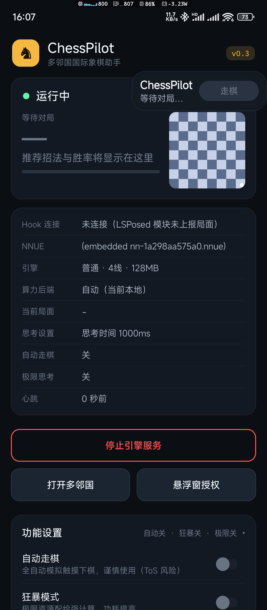
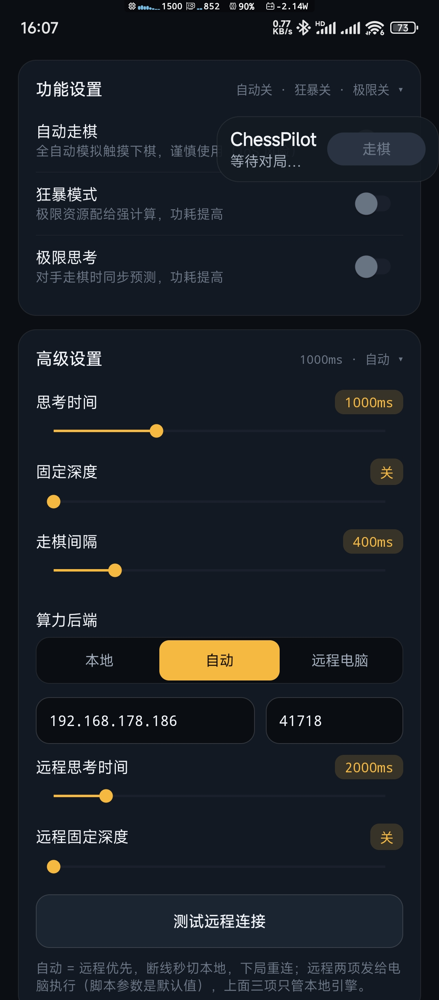
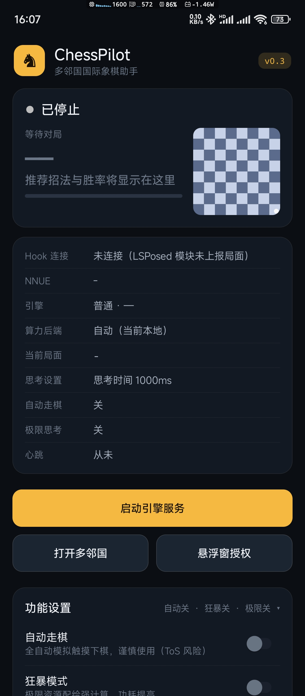

<div align="center">

# ♟️ ChessPilot · 多邻国国际象棋助手

**在多邻国国际象棋里实时看胜率、画推荐箭头、自动走棋 —— 手机自带引擎，或连电脑算力**

*LSPosed hook + Stockfish companion for Duolingo chess: live analysis,
best-move arrows on the board, optional autoplay — on-device or PC-powered.*

[](LICENSE)
[](https://github.com/a1175815821/ChessPilot/releases)
[](#-快速上手3-分钟)
[](https://github.com/a1175815821/ChessPilot/stargazers)

</div>

> ⚠️ **免责声明**：本项目会修改多邻国的运行行为，违反其服务条款，有封号风险。仅供学习研究，请用小号折腾。

---

## ✨ 它能做什么

| | 功能 | 一句话说明 |
|---|---|---|
| 🎯 | **实时分析** | Hook 棋盘拿到局面（FEN），Stockfish 秒级给出最佳招法和胜率 |
| ➡️ | **推荐箭头** | 直接画在多邻国棋盘上：金色＝推荐招法，红色＝预测对手的应招 |
| 🤖 | **自动走棋** | 可选自动落子（带延迟可调），或悬浮窗按钮半自动确认 |
| 🖥️ | **电脑算力** | 手机连电脑 Stockfish 19（NNUE），断线自动秒切回手机本地引擎 |
| 🧠 | **极限思考** | ponder：对手思考时预判他的招法，命中则瞬时出招 |
| 🔥 | **狂暴模式** | 线程拉满 ＋ 大内存，深算到底（悬浮窗红框角标） |
| 📊 | **控制台** | 对局雷达卡、FEN 小棋盘、事件终端，每个状态都看得见 |

<p align="center">
  
  
  
</p>


## 🚀 快速上手（3 分钟）

前提：手机已 root 并装好 **LSPosed（Zygisk）**，多邻国版本 `6.85.7`（arm64）。

1. 到 [Releases](https://github.com/a1175815821/ChessPilot/releases) 下载并安装两个包：
   `module-release-test.apk`（LSPosed 模块）＋ `app-release-test.apk`（伴侣 App）
2. LSPosed 里启用模块，作用域勾选**多邻国**，重启手机
3. 打开伴侣 App，点一次「启动引擎服务」（通知权限给一下）→ 进多邻国开一局，金色箭头就出现了

状态页怎么读、装完没反应怎么办 → [docs/USER_GUIDE.md](docs/USER_GUIDE.md)（含故障排查对照表）。

## 🖥️ 想更强？连电脑算力（可选）

手机芯片算不过桌面 CPU —— 让电脑替你算，手机只负责看和走：

1. 电脑上双击 `pc/start-pc-engine.bat`（只需 Python 3.8+，Stockfish 自动下载）
2. 手机控制页 → 高级设置 → 算力后端切「远程」，填电脑 IP

连接断了自动切回手机本地引擎，一局都不耽误。细节见 [pc/README.md](pc/README.md)。

## 🏗️ 它是怎么工作的

```
多邻国 App ──(LSPosed Hook：抓 FEN / Rive 画箭头 / 模拟点击)──▶ module
                                                              │ 回环 TCP 127.0.0.1:41717
                                                              ▼
伴侣 App（com.chessassist）：Stockfish 子进程 ＋ 悬浮窗 ＋ 控制页
                                                              │ 局域网 TCP :41718（可选）
                                                              ▼
                                            电脑 pc/pc_engine.py ＋ Stockfish 19
```

| 部分 | 是什么 |
|---|---|
| [module/](module) | LSPosed 模块（跑在多邻国进程内）：Hook 棋盘状态、驱动 Rive 控制器画箭头与走子、回环 TCP 通信 |
| [app/](app) | 伴侣 App：Stockfish 引擎（NNUE 烘进 so）、TCP 桥（JSON 行协议）、悬浮窗、控制页 |
| [pc/](pc) | 电脑算力端：纯 Python 标准库，零第三方依赖，引擎自动下载 |
| [docs/](docs) | 使用手册、逆向笔记（坐标映射、`remap.json` 再生流程）、设计系统（含[浏览器原型](docs/design/prototype.html)） |

> 为什么用 TCP 而不是 ContentProvider？Android 11+ 的包可见性限制让多邻国解析不了我们的组件，回环 socket 两边都不需要可见性 —— 踩坑实录在 [docs/REVERSE_ENGINEERING.md](docs/REVERSE_ENGINEERING.md)。

## 🛠️ 自己构建

```powershell
# 1. 取 Stockfish 源码（SF19，网名即哈希验货）
tools/fetch_stockfish.sh

# 2. 离线构建（仓库自带 gradle-8.7，JDK 17，需 ANDROID_HOME 指向 SDK）
.gradle-dist\gradle-8.7\bin\gradle.bat -p . :app:assembleRelease :module:assembleRelease --offline

# 3. 本地 debug.keystore 签名 → dist/
```

多邻国升级导致混淆名变了？不用慌：`tools/remap.py` 可以从新 APK 再生映射表，流程见逆向笔记。

仓库里不进 git 的东西（构建产物、Stockfish 源码、`dist/`、多邻国 APK）全部可按上述步骤再生。

## ⭐ 支持一下

如果这个项目帮到了你，或者 Hook 思路 / 引擎集成 / 抗混淆三层回退的设计对你有启发 ——
**点个 Star** 让更多人看到它。每一步折腾都记录在[更新日志](docs/USER_GUIDE.md)里，欢迎 issue 交流。

<div align="center">

[](https://star-history.com/#a1175815821/ChessPilot&Date)

</div>

## 📄 许可证

[GPL-3.0](LICENSE)。Stockfish 本体同为 GPL-3.0，分发二进制必须附带源码获取方式 —— 本仓库即源码（引擎取自官方 tag ＋ 构建脚本全开源）。
